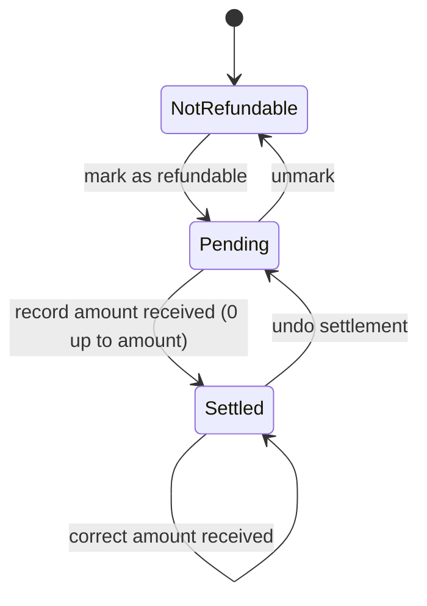

# Personal Budget App (offline iPhone app)

Vision: one offline iPhone app that replaces a personal budget spreadsheet: what I can still spend this month, where money went, what I own, and what is coming.

## Who, why
- **Role:** one person managing their own household money on one iPhone. No accounts, no backend, no sync.
- **Pain today:** updating a multi-sheet spreadsheet by hand: copy/paste recurring rows, fix dates, split refunds into "loss" rows, use negative amounts as a hack for money received, type ledger totals into the net-worth sheet.
- **Goal (state A to B):** from "open the spreadsheet and edit five sheets" to "add an entry on the phone and the remaining budget, net worth and reminders are already correct".
- **Three roles:**
  - User: time back, fewer mistakes, data that stays on the phone.
  - Customer (the public repo's audience): a clean, open-source example anyone can build with their own empty data.
  - Developer: pure core, thin screens, so changing a rule means changing one place.

## Capabilities and features
| Capability | Feature | Feature file |
|---|---|---|
| Budget | What is left to spend, and what was spent this month | `tests/budget/month-budget/month-budget.feature` |
| Budget | Record an expense | `tests/budget/expenses/record-expense.feature` |
| Budget | Track refunds and reimbursements (pending, settled, partial) | `tests/budget/expenses/refunds.feature` |
| Budget | Record income, savings, money received, borrowing | `tests/budget/income/record-income.feature` |
| Budget | Bills: one-off or repeating, with end date, added to the budget with a tap | `tests/budget/bills/bills.feature` |
| Budget | Planned expenses (no date yet) | `tests/budget/planning/planned-expenses.feature` |
| Budget | Categories with sub-categories | `tests/budget/categories/categories.feature` |
| Budget | Entities (shops and services) on expenses | `tests/budget/entities/entities.feature` |
| Budget | Spending in another currency | `tests/budget/currencies/foreign-currency-spending.feature` |
| Budget | Search expenses | `tests/budget/search/search-expenses.feature` |
| Settings | Preferences (currency, privacy, totals, due dates, filters) | `tests/settings/preferences/preferences.feature` |
| Budget | Card bills with a paid tick | `tests/budget/cards/card-bills.feature` |
| Budget | Amount to repay | `tests/budget/borrowing/amount-to-repay.feature` |
| Budget | Cash in hand (separate from the bank budget) | `tests/budget/cash-in-hand/cash-in-hand.feature` |
| Insights | Where the money went | `tests/insights/spending-breakdown/spending-breakdown.feature` |
| Net worth | Portfolio and net worth | `tests/networth/portfolio/portfolio.feature` |
| Net worth | People ledgers (money held for or from others) | `tests/networth/ledgers/ledgers.feature` |
| Net worth | Payout schemes and maturity reminders | `tests/networth/payout-schemes/payout-schemes.feature` |
| Data | Fresh install, backup and restore | `tests/data/backup-and-restore/backup-and-restore.feature` |
| Data | One-time spreadsheet import (Mac tool) | `tests/data/spreadsheet-import/spreadsheet-import.feature` |

## Rules decided with the owner
- **Month** is the calendar month. Salary is entered on the last working day; next month's bills are added the same day so "left to spend" already reflects them.
- **Left to spend** is what is left in the bank for bank, card and withdrawal spending. It is all-time: salary + investment income + money received + borrowed - savings - repaid - net expenses paid from the bank or a card. **Spent this month** is for the month being viewed.
- **Every payment method has a kind**, and the kind decides what an expense touches:

| Kind | Examples | Left to spend | Also changes |
|---|---|---|---|
| Bank | UPI, bank transfer | drops | - |
| Card | credit cards, a family-held card | drops | Card Bills |
| Withdrawal | cash withdrawal | drops | cash in hand, only if kept for myself |
| Cash in hand | cash | unchanged | cash in hand drops |
| Ledger | a person's ledger | unchanged | that ledger drops |

  Insights count all kinds, so cash and ledger spending is still visible.
- **Net amount** = amount - received. No separate "loss" entries.
- **Refund lifecycle:** not refundable, pending, settled (with the amount received, possibly 0).
- **Money received** is its own income type. The negative-amount hack goes away.
- **Bills** replace recurring and dated upcoming items. A bill repeats (12 choices) and can end on a date or never; "Change Plan" ends one bill and starts the next. A repeating bill can add itself on its due date (when the app is opened) and tells the owner; other bills wait in Upcoming for a tap. Items with no date are **Planned** and never change the budget.
- **Expected income** (payouts) is recorded through a confirmation showing date and amount, since payouts can land a day early or late. It counts on the Bills tab from a chosen number of days before.
- **Privacy:** the savings bank balance and the whole Portfolio are hidden by default; the eye reveals them after Face ID (device passcode as fallback).
- **Entities:** an expense has a short description and an optional entity (the shop or service). Lists show the description; the entity shows when the expense is opened and in Reports and Search.
- **Categories** are parents with sub-categories, each with a colour and icon, added and merged by the owner.
- **Currencies:** all totals are in the home currency. A foreign expense keeps its currency, amount and the rate the owner actually got, typed by hand. The home currency is locked once records exist.
- **Navigation:** floating tab bar Activity, Bills, Portfolio, Reports, Search; a profile button opens a menu (categories, entities, ledgers, card bills, cash in hand, amount to repay, pending refunds, export and import, settings). There is no Reminders tab: bills and expected payouts are on Bills, and a count on the Bills tab shows what needs attention.
- **Cash:** a withdrawal is an ordinary expense because the money left the bank. If it is kept for myself it also fills cash in hand; if it is handed to family nothing more is tracked. Spending from cash in hand never touches the bank budget.
- **Paying from a ledger:** an expense can be paid from a person's ledger. It lowers that ledger, not left to spend, because that money was never mine to spend.
- **Ledgers:** every person who has money in my account gets a ledger. A ledger flag says whether that balance counts toward my net worth. Borrowing from my own savings never changes any ledger.
- **Pending refunds** can be viewed on their own, across all months.
- **Net worth** = available for allocation + investments + ledgers flagged as mine.
- **Card bills:** per card and month, total of (amount - received) with a paid tick. Family-held cards are cards like any other.
- **Payout amounts are approximate** (month length changes them), so recording a payout always lets me edit the amount.
- **Privacy:** the repo carries no personal data. A fresh install is empty with generic default categories.

## State: refund lifecycle

Forbidden: record received on a non-refundable expense; received above the amount; negative received.

## Concrete example (made-up)
Priya books a 1,200 train ticket and marks it refundable. The trip is cancelled and 900 comes back. She records 900 received. Net is 300, the ticket moves from pending to settled, and left-to-spend rises by 900.

## Open guesses (please confirm)
1. Income & Expense Settings toggles: confirmed by the owner.
2. App Lock (Face ID or Touch ID): stays in; to be checked inside LiveContainer when built.
3. Cash in hand stays in the home currency (confirmed).
4. **Entity prefix split** at import is driven by the personal mapping file, not guessed.
5. **Categories:** final set agreed with the owner (see `tests/budget/categories/categories.feature`); Personal and Family are being split into two separate categories.

Confirmed by the owner: repaying borrowed money lowers left to spend; card bill is amount minus received; one-tap payout recording; pending refunds all-time and settled amounts by month; no partial-ledger-payment modelling (a bill is paid from one source); cash expenses cannot be refunded (cash that has left the bank is gone); a refund on a ledger-paid expense goes back to that ledger; cash in hand and ledgers may go negative with a warning, never blocked.

## Planned later: Splitwise-style balances (not started)
When the app runs the way the owner wants for personal use, add a section that shows who owes whom and how much, like Splitwise:
- a list of people with a balance each: they owe me, I owe them, or settled;
- built on the "Spent for" field (an expense paid for someone else), ledgers and Amount to Repay, so most of the data already exists;
- shared and split expenses (for example trips), settling up, and a running total per person.
This needs its own `clarify-requirements` round and approved feature file before any build. Nothing in the current build should block it: keep "Spent for" as a person reference, not free text.

## Out of scope (now)
- Splitwise-style balances and shared trip expenses (see "Planned later" above).
- Notifications (reminders are an in-app tab).
- Cloud sync, accounts, multi-user, UPI barcode sheet, live currency rates.
