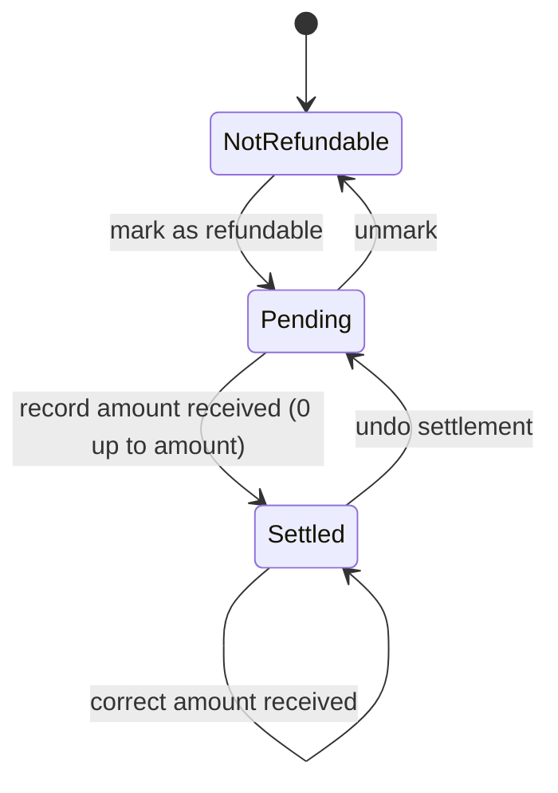

# Personal Budget App (offline iPhone app)

Vision: one offline iPhone app that replaces a personal budget spreadsheet: what I can still spend this month, where money went, what I own, and what is coming.

## Who, why
- **Role:** one person managing their own household money on one iPhone. No accounts, no backend, no sync.
- **Pain today:** updating a multi-sheet spreadsheet by hand: copy/paste recurring rows, fix dates, split refunds into "loss" rows, use negative amounts as a hack for money received, type ledger totals into the net-worth sheet.
- **Goal (state A to B):** from "open the spreadsheet and edit five sheets" to "add an entry on the phone and the remaining budget, net worth and reminders are already correct".
- **Three roles:**
  - User: time back, fewer mistakes, data that stays on the phone.
  - Customer (the public repo's audience): a clean, open-source example anyone can build with their own empty data.
  - Developer: pure core, thin screens, so changing a rule means changing one place.

## Capabilities and features
| Capability | Feature | Feature file |
|---|---|---|
| Budget | What is left to spend, and what was spent this month | `tests/budget/month-budget/month-budget.feature` |
| Budget | Record an expense | `tests/budget/expenses/record-expense.feature` |
| Budget | Track refunds and reimbursements (pending, settled, partial) | `tests/budget/expenses/refunds.feature` |
| Budget | Record income, savings, money received, borrowing | `tests/budget/income/record-income.feature` |
| Budget | Recurring expenses added with one tap | `tests/budget/planning/recurring-expenses.feature` |
| Budget | Upcoming expenses (heads-up list) | `tests/budget/planning/upcoming-expenses.feature` |
| Budget | Card bills with a paid tick | `tests/budget/cards/card-bills.feature` |
| Budget | Amount to repay | `tests/budget/borrowing/amount-to-repay.feature` |
| Budget | Cash in hand (separate from the bank budget) | `tests/budget/cash-in-hand/cash-in-hand.feature` |
| Insights | Where the money went | `tests/insights/spending-breakdown/spending-breakdown.feature` |
| Net worth | Portfolio and net worth | `tests/networth/portfolio/portfolio.feature` |
| Net worth | People ledgers (money held for or from others) | `tests/networth/ledgers/ledgers.feature` |
| Net worth | Payout schemes and maturity reminders | `tests/networth/payout-schemes/payout-schemes.feature` |
| Data | Fresh install, backup and restore | `tests/data/backup-and-restore/backup-and-restore.feature` |
| Data | One-time spreadsheet import (Mac tool) | `tests/data/spreadsheet-import/spreadsheet-import.feature` |

## Rules decided with the owner
- **Month** is the calendar month. Salary is entered on the last working day; next month's recurring items are added the same day so "left to spend" already reflects them.
- **Left to spend** is what is left in the bank for bank, card and withdrawal spending. It is all-time: salary + investment income + money received + borrowed - savings - repaid - net expenses paid from the bank or a card. **Spent this month** is for the month being viewed.
- **Every payment method has a kind**, and the kind decides what an expense touches:

| Kind | Examples | Left to spend | Also changes |
|---|---|---|---|
| Bank | UPI, bank transfer | drops | - |
| Card | credit cards, a family-held card | drops | Card Bills |
| Withdrawal | cash withdrawal | drops | cash in hand, only if kept for myself |
| Cash in hand | cash | unchanged | cash in hand drops |
| Ledger | a person's ledger | unchanged | that ledger drops |

  Insights count all kinds, so cash and ledger spending is still visible.
- **Net amount** = amount - received. No separate "loss" entries.
- **Refund lifecycle:** not refundable, pending, settled (with the amount received, possibly 0).
- **Money received** is its own income type. The negative-amount hack goes away.
- **Upcoming** items are a heads-up only and never change the budget. Recurring items do change it, once added.
- **Cash:** a withdrawal is an ordinary expense because the money left the bank. If it is kept for myself it also fills cash in hand; if it is handed to family nothing more is tracked. Spending from cash in hand never touches the bank budget.
- **Paying from a ledger:** an expense can be paid from a person's ledger. It lowers that ledger, not left to spend, because that money was never mine to spend.
- **Ledgers:** every person who has money in my account gets a ledger. A ledger flag says whether that balance counts toward my net worth. Borrowing from my own savings never changes any ledger.
- **Pending refunds** can be viewed on their own, across all months.
- **Net worth** = available for allocation + investments + ledgers flagged as mine.
- **Card bills:** per card and month, total of (amount - received) with a paid tick. Family-held cards are cards like any other.
- **Payout amounts are approximate** (month length changes them), so recording a payout always lets me edit the amount.
- **Privacy:** the repo carries no personal data. A fresh install is empty with generic default categories.

## State: refund lifecycle

Forbidden: record received on a non-refundable expense; received above the amount; negative received.

## Concrete example (made-up)
Priya books a 1,200 train ticket and marks it refundable. The trip is cancelled and 900 comes back. She records 900 received. Net is 300, the ticket moves from pending to settled, and left-to-spend rises by 900.

## Open guesses (please confirm)
1. None open. Cash in hand is in this phase and is the last slice to build.

Confirmed by the owner: repaying borrowed money lowers left to spend; card bill is amount minus received; one-tap payout recording; pending refunds all-time and settled amounts by month; no partial-ledger-payment modelling (a bill is paid from one source); cash expenses cannot be refunded (cash that has left the bank is gone); a refund on a ledger-paid expense goes back to that ledger; cash in hand and ledgers may go negative with a warning, never blocked.

## Out of scope (now)
- Shared trip expenses and who-owes-whom (planned as the next phase, after the owner verifies this app).
- Notifications (reminders are an in-app tab).
- Cloud sync, accounts, multi-user, UPI barcode sheet, live currency rates.
